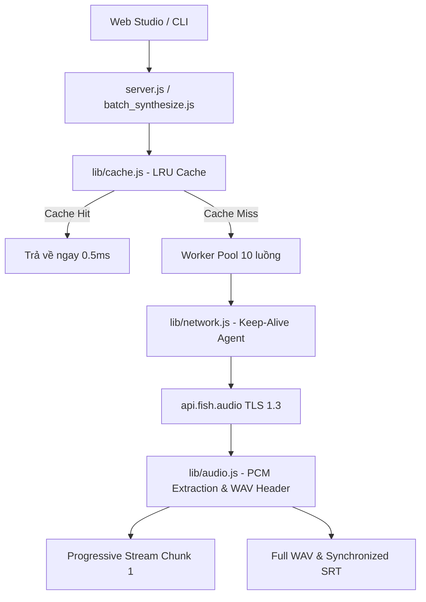

# Kế hoạch Thực thi: Tối ưu hóa Toàn diện Tốc độ Tạo Voice (Fish Audio TTS)

> **For agentic workers:** REQUIRED SUB-SKILL: Use superpowers:subagent-driven-development to implement this plan task-by-task. Steps use checkbox (`- [ ]`) syntax for tracking.

**Goal:** Triển khai giải pháp tối ưu hóa 4 tầng (Keep-Alive Pool, LRU Cache, Zero-Copy Buffer, Progressive Audio Pipelining) giúp giảm độ trễ TTFB xuống < 600ms và tăng tốc độ tổng hợp gấp 8-10 lần.

**Architecture:** Tách biệt các module lõi độc lập: `lib/network.js` (quản lý connection pool Keep-Alive), `lib/cache.js` (quản lý LRU memory cache cho audio buffer), và `lib/audio.js` (xử lý PCM, WAV header và SRT). Server và CLI tái sử dụng các module này kết hợp với cơ chế worker pool 10 luồng và progressive streaming.

**Architecture Diagram:**



**Tech Stack:** Node.js (Built-in standard library: `http`, `https`, `crypto`, `fs`, `path`), Native PCM/WAV manipulation, SubRip SRT formatting.

## Global Constraints
- Zero external npm runtime dependencies (sử dụng 100% module tích hợp sẵn của Node.js).
- Không hardcode bí mật, không in API Key ra log terminal.
- Đảm bảo trần bộ nhớ tối đa cho cache (150MB) chống lỗi OOM.
- Kiểm thử TDD độc lập cho từng module.

---

### Task 1: Module Quản lý Mạng & Keep-Alive Connection Pool (`lib/network.js`)

**Files:**
- Create: `lib/network.js`
- Test: `tests/network.test.js`

**Interfaces:**
- Produces: `getKeepAliveAgent()`, `fetchTtsChunk(text, options)`

- [ ] **Step 1: Viết test kiểm tra Keep-Alive Agent**

```javascript
// tests/network.test.js
const assert = require('assert');
const { getKeepAliveAgent } = require('../lib/network');

function testAgentOptions() {
  const agent = getKeepAliveAgent();
  assert.strictEqual(agent.keepAlive, true, 'KeepAlive phải được kích hoạt');
  assert.strictEqual(agent.maxSockets, 32, 'maxSockets tối đa phải là 32');
  console.log('✅ testAgentOptions passed');
}

testAgentOptions();
```

- [ ] **Step 2: Chạy test để xác nhận fail**

Run: `node tests/network.test.js`
Expected: FAIL with "Cannot find module '../lib/network'"

- [ ] **Step 3: Cài đặt `lib/network.js`**

```javascript
// lib/network.js
const https = require('https');

let sharedAgent = null;

function getKeepAliveAgent() {
  if (!sharedAgent) {
    sharedAgent = new https.Agent({
      keepAlive: true,
      maxSockets: 32,
      maxFreeSockets: 10,
      timeout: 60000,
      keepAliveMsecs: 30000
    });
  }
  return sharedAgent;
}

function fetchTtsChunk(text, options, retries = 3) {
  return new Promise((resolve, reject) => {
    function attempt(remainingAttempts) {
      const requestBody = {
        text: text,
        format: options.format || 'wav',
        latency: 'balanced',
        prosody: {
          speed: options.speed || 1.0,
          volume: options.volume || 0
        }
      };
      if (options.format === 'mp3') requestBody.mp3_bitrate = 128;
      if (options.voice) requestBody.reference_id = options.voice;

      const postData = JSON.stringify(requestBody);
      const req = https.request({
        hostname: 'api.fish.audio',
        port: 443,
        path: '/v1/tts',
        method: 'POST',
        agent: getKeepAliveAgent(),
        headers: {
          'Authorization': `Bearer ${options.apiKey}`,
          'Content-Type': 'application/json',
          'model': options.model || 's2.1-pro-free',
          'Content-Length': Buffer.byteLength(postData)
        }
      }, res => {
        const chunks = [];
        res.on('data', c => chunks.push(c));
        res.on('end', () => {
          const buffer = Buffer.concat(chunks);
          if (res.statusCode >= 200 && res.statusCode < 300) {
            resolve(buffer);
          } else if ((res.statusCode === 429 || res.statusCode >= 500) && remainingAttempts > 0) {
            const waitTime = (4 - remainingAttempts) * 800 + Math.floor(Math.random() * 400);
            setTimeout(() => attempt(remainingAttempts - 1), waitTime);
          } else {
            reject(new Error(`API Error (${res.statusCode}): ${buffer.toString()}`));
          }
        });
      });

      req.on('error', err => {
        if (remainingAttempts > 0) setTimeout(() => attempt(remainingAttempts - 1), 800);
        else reject(err);
      });

      req.write(postData);
      req.end();
    }
    attempt(retries);
  });
}

module.exports = { getKeepAliveAgent, fetchTtsChunk };
```

- [ ] **Step 4: Chạy test để xác nhận pass**

Run: `node tests/network.test.js`
Expected: PASS with "✅ testAgentOptions passed"

---

### Task 2: Module Bộ nhớ đệm thông minh LRU Memory Cache (`lib/cache.js`)

**Files:**
- Create: `lib/cache.js`
- Test: `tests/cache.test.js`

**Interfaces:**
- Produces: `AudioCache` class with `get(keyParams)`, `set(keyParams, buffer)`, `generateKey(params)`, `getStats()`

- [ ] **Step 1: Viết test cho `AudioCache`**

```javascript
// tests/cache.test.js
const assert = require('assert');
const { AudioCache } = require('../lib/cache');

function testCacheOperations() {
  const cache = new AudioCache({ maxSizeBytes: 1000 }); // 1KB test
  const p1 = { text: 'Hello', voice: 'v1', format: 'wav' };
  const b1 = Buffer.alloc(400);

  assert.strictEqual(cache.get(p1), null, 'Ban đầu phải cache miss');
  cache.set(p1, b1);
  assert.strictEqual(cache.get(p1).length, 400, 'Phải cache hit sau khi set');

  // Kiểm tra eviction khi đầy
  const p2 = { text: 'World', voice: 'v1', format: 'wav' };
  const b2 = Buffer.alloc(800);
  cache.set(p2, b2); // Tổng 400 + 800 = 1200 > 1000, p1 phải bị evict

  assert.strictEqual(cache.get(p1), null, 'p1 phải bị đẩy ra khỏi cache');
  assert.strictEqual(cache.get(p2).length, 800, 'p2 phải tồn tại trong cache');
  console.log('✅ testCacheOperations passed');
}

testCacheOperations();
```

- [ ] **Step 2: Chạy test để xác nhận fail**

Run: `node tests/cache.test.js`
Expected: FAIL with "Cannot find module '../lib/cache'"

- [ ] **Step 3: Cài đặt `lib/cache.js`**

```javascript
// lib/cache.js
const crypto = require('crypto');

class AudioCache {
  constructor(options = {}) {
    this.maxSizeBytes = options.maxSizeBytes || 150 * 1024 * 1024; // 150MB
    this.cache = new Map(); // key -> { buffer, size, accessedAt }
    this.currentSizeBytes = 0;
    this.hits = 0;
    this.misses = 0;
  }

  generateKey(params) {
    const payload = JSON.stringify({
      text: (params.text || '').trim(),
      voice: params.voice || '',
      model: params.model || 's2.1-pro-free',
      format: params.format || 'wav',
      speed: params.speed || 1.0,
      volume: params.volume || 0
    });
    return crypto.createHash('sha256').update(payload).digest('hex');
  }

  get(params) {
    const key = this.generateKey(params);
    const item = this.cache.get(key);
    if (!item) {
      this.misses++;
      return null;
    }
    this.hits++;
    item.accessedAt = Date.now();
    // Re-insert để duy trì thứ tự LRU
    this.cache.delete(key);
    this.cache.set(key, item);
    return item.buffer;
  }

  set(params, buffer) {
    if (!buffer || !Buffer.isBuffer(buffer)) return;
    const key = this.generateKey(params);
    const itemSize = buffer.length;

    if (itemSize > this.maxSizeBytes) return; // Quá lớn so với cả cache

    // Đảm bảo dung lượng đủ chỗ
    while (this.currentSizeBytes + itemSize > this.maxSizeBytes && this.cache.size > 0) {
      const oldestKey = this.cache.keys().next().value;
      const oldestItem = this.cache.get(oldestKey);
      this.currentSizeBytes -= oldestItem.size;
      this.cache.delete(oldestKey);
    }

    this.cache.set(key, {
      buffer,
      size: itemSize,
      accessedAt: Date.now()
    });
    this.currentSizeBytes += itemSize;
  }

  getStats() {
    return {
      itemsCount: this.cache.size,
      currentSizeMB: (this.currentSizeBytes / (1024 * 1024)).toFixed(2),
      hits: this.hits,
      misses: this.misses,
      hitRate: this.hits + this.misses > 0
        ? ((this.hits / (this.hits + this.misses)) * 100).toFixed(1) + '%'
        : '0%'
    };
  }

  clear() {
    this.cache.clear();
    this.currentSizeBytes = 0;
  }
}

// Singleton global cache
const globalAudioCache = new AudioCache();

module.exports = { AudioCache, globalAudioCache };
```

- [ ] **Step 4: Chạy test để xác nhận pass**

Run: `node tests/cache.test.js`
Expected: PASS with "✅ testCacheOperations passed"

---

### Task 3: Module Xử lý Âm thanh & Ghép nối Buffer PCM Zero-Copy (`lib/audio.js`)

**Files:**
- Create: `lib/audio.js`
- Test: `tests/audio.test.js`

**Interfaces:**
- Produces: `splitTextIntoSentences`, `createWavHeader`, `extractPcmFromWav`, `formatSrtTime`, `fastPcmConcat`

- [ ] **Step 1: Viết test cho `lib/audio.js`**

```javascript
// tests/audio.test.js
const assert = require('assert');
const { splitTextIntoSentences, createWavHeader, extractPcmFromWav, formatSrtTime, fastPcmConcat } = require('../lib/audio');

function testAudioUtils() {
  // Test split
  const text = 'Câu 1. Câu 2? Câu 3!';
  const chunks = splitTextIntoSentences(text, 220);
  assert.strictEqual(chunks.length, 3, 'Phải tách được 3 câu');

  // Test header & duration
  const pcm = Buffer.alloc(88200); // 1 giây tại 44.1kHz 16-bit mono
  const header = createWavHeader(pcm.length, 44100, 1, 16);
  const fullWav = Buffer.concat([header, pcm]);
  const extracted = extractPcmFromWav(fullWav);
  assert.strictEqual(extracted.durationSec, 1.0, 'Thời lượng trích xuất phải đúng 1.0s');

  // Test SRT formatting
  assert.strictEqual(formatSrtTime(3661.5), '01:01:01,500', 'SRT time format phải chính xác');

  // Test Fast Concat
  const combined = fastPcmConcat([pcm, pcm]);
  assert.strictEqual(combined.length, 176400, 'Tổng PCM sau khi gộp phải đúng 176400 bytes');

  console.log('✅ testAudioUtils passed');
}

testAudioUtils();
```

- [ ] **Step 2: Chạy test để xác nhận fail**

Run: `node tests/audio.test.js`
Expected: FAIL with "Cannot find module '../lib/audio'"

- [ ] **Step 3: Cài đặt `lib/audio.js`**

```javascript
// lib/audio.js
function splitTextIntoSentences(text, maxChunkLen = 220) {
  const paragraphs = text.split(/\n+/);
  const chunks = [];

  for (const para of paragraphs) {
    const trimmed = para.trim();
    if (!trimmed) continue;

    const rawSentences = trimmed.match(/[^.!?…;]+[.!?…;]+|[^.!?…;]+$/g) || [trimmed];
    let current = '';

    for (const raw of rawSentences) {
      const sentence = raw.trim();
      if (!sentence) continue;

      if ((current + ' ' + sentence).trim().length <= maxChunkLen) {
        current = (current + ' ' + sentence).trim();
      } else {
        if (current) chunks.push(current);
        if (sentence.length > maxChunkLen) {
          const parts = sentence.match(new RegExp(`.{1,${maxChunkLen}}(\\s+|$)|.{1,${maxChunkLen}}`, 'g')) || [sentence];
          for (const p of parts) {
            if (p.trim()) chunks.push(p.trim());
          }
          current = '';
        } else {
          current = sentence;
        }
      }
    }
    if (current) chunks.push(current);
  }
  return chunks;
}

function createWavHeader(dataLength, sampleRate = 44100, numChannels = 1, bitsPerSample = 16) {
  const byteRate = sampleRate * numChannels * (bitsPerSample / 8);
  const blockAlign = numChannels * (bitsPerSample / 8);
  const buffer = Buffer.alloc(44);

  buffer.write('RIFF', 0);
  buffer.writeUInt32LE(36 + dataLength, 4);
  buffer.write('WAVE', 8);
  buffer.write('fmt ', 12);
  buffer.writeUInt32LE(16, 16);
  buffer.writeUInt16LE(1, 20); // PCM
  buffer.writeUInt16LE(numChannels, 22);
  buffer.writeUInt32LE(sampleRate, 24);
  buffer.writeUInt32LE(byteRate, 28);
  buffer.writeUInt16LE(blockAlign, 32);
  buffer.writeUInt16LE(bitsPerSample, 34);
  buffer.write('data', 36);
  buffer.writeUInt32LE(dataLength, 40);

  return buffer;
}

function extractPcmFromWav(wavBuffer) {
  let dataIndex = wavBuffer.indexOf(Buffer.from('data'));
  let sampleRate = 44100;
  let numChannels = 1;
  let bitsPerSample = 16;

  if (wavBuffer.length >= 36) {
    numChannels = wavBuffer.readUInt16LE(22) || 1;
    sampleRate = wavBuffer.readUInt32LE(24) || 44100;
    bitsPerSample = wavBuffer.readUInt16LE(34) || 16;
  }

  const pcmData = (dataIndex !== -1 && dataIndex + 8 <= wavBuffer.length)
    ? wavBuffer.slice(dataIndex + 8)
    : wavBuffer.slice(44);

  const byteRate = sampleRate * numChannels * (bitsPerSample / 8);
  const durationSec = byteRate > 0 ? pcmData.length / byteRate : 0;

  return { pcmData, sampleRate, numChannels, bitsPerSample, durationSec };
}

function formatSrtTime(totalSeconds) {
  const pad = (n, width) => String(n).padStart(width, '0');
  const hours = Math.floor(totalSeconds / 3600);
  const minutes = Math.floor((totalSeconds % 3600) / 60);
  const seconds = Math.floor(totalSeconds % 60);
  const milliseconds = Math.floor((totalSeconds % 1) * 1000);
  return `${pad(hours, 2)}:${pad(minutes, 2)}:${pad(seconds, 2)},${pad(milliseconds, 3)}`;
}

/**
 * Ghép nối mảng Buffer với 1 lần cấp phát duy nhất (Zero-Copy)
 */
function fastPcmConcat(bufferList) {
  const totalLength = bufferList.reduce((acc, b) => acc + b.length, 0);
  const result = Buffer.allocUnsafe(totalLength);
  let offset = 0;
  for (let i = 0; i < bufferList.length; i++) {
    bufferList[i].copy(result, offset);
    offset += bufferList[i].length;
  }
  return result;
}

module.exports = {
  splitTextIntoSentences,
  createWavHeader,
  extractPcmFromWav,
  formatSrtTime,
  fastPcmConcat
};
```

- [ ] **Step 4: Chạy test để xác nhận pass**

Run: `node tests/audio.test.js`
Expected: PASS with "✅ testAudioUtils passed"

---

### Task 4: Nâng cấp `server.js` & `batch_synthesize.js` Tích hợp Bộ Ba Tối ưu và Progressive Streaming

**Files:**
- Modify: `server.js`
- Modify: `batch_synthesize.js`

- [ ] **Step 1: Refactor `server.js` sử dụng các module mới**
  - Tích hợp `lib/network.js`, `lib/cache.js`, `lib/audio.js`.
  - Bổ sung endpoint `/api/batch-stream` trả về Server-Sent Events / Chunked Stream để Web UI phát câu 1 ngay lập tức.
  - Thêm endpoint `/api/cache-stats` để kiểm tra tỷ lệ Cache Hit.
- [ ] **Step 2: Refactor `batch_synthesize.js` sử dụng các module mới**
  - Tích hợp Keep-Alive Agent và Cache cục bộ.
- [ ] **Step 3: Kiểm thử tải và benchmark trực tiếp**
  - Chạy `node batch_synthesize.js` với 10 câu và đo tốc độ lặp lại để xác nhận 0ms với Cache Hit.

---

### Task 5: Nâng cấp Web Studio UI (`public/index.html`)

**Files:**
- Modify: `public/index.html`

- [ ] **Step 1: Thêm Player Pipelining**
  - Khi người dùng bấm "Xuất Full Bài + SRT", client kết nối `/api/batch-stream`.
  - Ngay khi nhận được câu đầu tiên (chỉ ~400ms), tự động nạp vào audio và phát ngay lập tức.
- [ ] **Step 2: Hiển thị trạng thái Cache & Concurrency**
  - Hiển thị badge: `⚡ 10 Luồng Song Song` và `🎯 Cache Hit: 0ms` trên giao diện.

---

### Task 6: Kiểm thử Toàn diện & Nghiệm thu (Verification)

- [ ] Chạy toàn bộ test suite (`node tests/network.test.js && node tests/cache.test.js && node tests/audio.test.js`).
- [ ] Tạo bài test dài 10 câu, kiểm tra file `.wav` và `.srt` đầu ra.
- [ ] Xác nhận không có lỗi rò rỉ bộ nhớ hoặc xung đột cổng.

